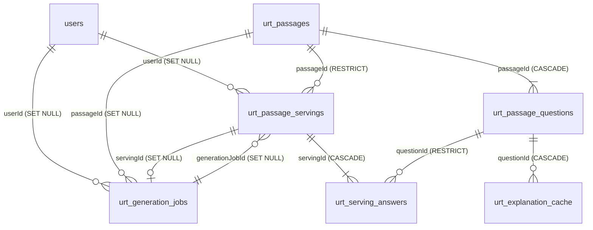

# URT passage generator tables (section to merge into `docs/database_system.md`)

> Status: **draft for review** (milestone M5). Migration: `server/migrations/20261101000001-create-urt-tables.cjs`.
> Adds seven new `urt_*` tables; **no existing table is altered**. The only reference to a platform
> table is `users.id`.

All tables: InnoDB, `utf8mb4`, camelCase columns, `createdAt`/`updatedAt`. Models live in
`server/models/urt*Model.js`; associations in `server/models/associations.urt.js`; shared enum
values in `server/models/urtConstants.js`.

## Tables

| Table | Purpose | Key columns |
|---|---|---|
| `urt_rule_sets` | Mirror of each approved rules file (the YAML in git is the source of truth) | UNIQUE `(subject, rulesVersion)` |
| `urt_passages` | The shared pool of validated generated passages; `serveCount = 0` means fresh | UNIQUE `contentHash`; INDEX `(subject, status, serveCount)`, `(subject, topicId)`, `(rulesVersion)` |
| `urt_passage_questions` | Multiple-choice questions of a passage (field shape copied from `quiz_questions`) | UNIQUE `(passageId, orderIndex)` |
| `urt_generation_jobs` | Generation jobs (`CHAR(36)` UUID ids) and their token cost | INDEX `(status)`, `(userId, status)` |
| `urt_passage_servings` | Which passage was served to which student, and whether it was fresh (`source`) | UNIQUE `(userId, passageId)`; INDEX `(userId, servedAt)` |
| `urt_serving_answers` | A student's answer per question, with the explanation for wrong/unanswered ones | UNIQUE `(servingId, questionId)` |
| `urt_explanation_cache` | Feedback cached per (question, chosen answer, prompt version) | UNIQUE `(questionId, chosenAnswer, promptVersion)` |

Full column lists: PLAN.md §8 (the migration follows it exactly; additions are listed below).

## Relationships and delete behaviour

- **Deleting a user** sets `userId` to NULL on their servings and jobs; passages stay in the pool.
  The unique `(userId, passageId)` index allows repeated NULLs, so anonymised rows never collide.
- **A served passage cannot be deleted** (`RESTRICT`); it is retired (`status = 'retired'`,
  `retiredAt`, `retiredReason`). A never-served passage can be deleted with its questions.
- `urt_generation_jobs.servingId` and `urt_passage_servings.generationJobId` reference each other;
  the migration adds the jobs → servings foreign key after both tables exist and drops it first in `down`.

## Invariants enforced by the schema

1. A student is never served the same passage twice: UNIQUE `(userId, passageId)` (plus a code check).
2. Only validated passages exist in `urt_passages`; rejected drafts are never stored.
3. `source` is always stored (`NOT NULL`); the serving rule reads only persisted servings.
4. Answer keys are excluded by default: `UrtPassageQuestion`'s default scope omits `correctAnswer` and
   `distractorRationale`; grading must use `UrtPassageQuestion.scope('withKey')`.

## Values worth knowing

- `urt_passages.embedding`: float32 little-endian BLOB, 1536 dimensions for `text-embedding-3-small`
  (6 KB per passage); `embeddingModel` records the model so a mismatch can be refused.
- `urt_serving_answers.answer` NULL = unanswered (counts as incorrect and gets an explanation).
- `urt_explanation_cache.chosenAnswer` is `''` for unanswered questions (a NULL would defeat the unique key).

## Additions beyond PLAN.md §8 (for review)

- `urt_rule_sets.retiredAt` (DATETIME NULL): when a version was retired.
- `urt_generation_jobs` gets explicit foreign keys for `passageId`, `servingId` (SET NULL) and
  `urt_passage_servings.generationJobId` → jobs (SET NULL); §8 listed these columns without saying.
- `urt_serving_answers.questionId` is `RESTRICT` (§8 left it unspecified).
- Default values: `serveCount 0`, `attempts 0`, token counts and `costUsd 0`, `status` per table,
  `servedAt` now.

## Merge points (to confirm with the platform team)

| Assumption | Where | If different |
|---|---|---|
| Migrations live in `server/migrations/` and run with sequelize-cli (CommonJS `.cjs`) — OPEN-3 | migration file | move/rename the file |
| The Sequelize instance is the default export of `server/config/database.js` | every `urt*Model.js` (one import line) | change that import |
| The User model is the default export of `server/models/userModel.js` | `associations.urt.js` | change that import |
| `users.id` is a signed `INT` (PLAN §2 says INTEGER) | FKs in the migration | use `INTEGER.UNSIGNED` for `userId` if `users.id` is unsigned, or the FK will fail |
| Collation `utf8mb4_0900_ai_ci` (MySQL 8 default) | `TABLE_OPTIONS` in the migration | match the platform's collation |
| `associations.js` calls `applyUrtAssociations()` after User is defined | `associations.urt.js` | paste the function body instead |
