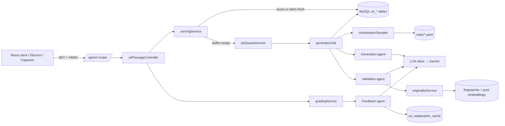

# URT Passage Generator: Full Project Plan

| | |
|---|---|
| Version | 3 (full plan; replaces v1 in chat and the v2 decisions file) |
| Date | 2026-10-24 |
| Target | ElRokh Academy monorepo: `/server` (Express 5 ESM, Node 20+, Sequelize, MySQL 8.0) |
| Status | Phase 0 approved. Phase 1 Step A built; the sample run is next. |

Items marked **OPEN** still need a decision (see §18). Nothing in the platform database
changes until the migrations in §8 are approved.

---

## 1. Purpose and scope

The service gives students URT exam passages (physics, chemistry, geology, biology,
english). Each passage comes with multiple-choice questions, and explanations for the
questions the student got wrong.

- **The only input is the subject.** The student comes from the logged-in session.
- Topic, style, difficulty, length, figures and the question set are chosen from the
  **generation rules**. These are produced once from the existing exam PDFs (Phase 1) and
  reviewed by hand.
- Passages are original. The generator works from the rules and never sees a source passage.
- Every passage is validated before it is stored or served. A student never sees the same
  passage twice.
- The pool grows over time, and generated passages are shared with other students.

Out of scope: adapting difficulty to each student, languages other than English, and any
recurring ingestion of new PDFs.

---

## 2. Platform context (from `project_structure.md` and `database_system.md`)

- **Students** are `users.id` (INTEGER), with `role` defaulting to `'student'`. Authentication
  is `server/middleware/userAuth.js` (JWT or session). Mobile and desktop requests are
  HMAC-signed (ADR 001, `electronProtection.js`).
- **Nothing exists yet** for passages, subjects, serving history, generation rules,
  embeddings or generation jobs. `quiz_questions` has a useful field shape (`type`,
  `question`, `options` JSON, `correctAnswer` JSON, `explanation`), but it is tied to
  `quizzes` and to the course, module and part tree. We copy the shape, not the table.
- **Conventions.** Most tables are snake_case plural with camelCase columns (`quiz_questions.quizId`,
  `createdAt`). Exceptions exist: `offline_downloads` has snake_case columns, and
  `PaymentForms` is a PascalCase table. We follow the majority and prefix every table with `urt_`.
- **Model file names.** The placement guide says `PascalCaseModel.js`, but the actual files
  are camelCase (`userModel.js`). We follow the actual files: `urtPassageModel.js`.
- **Background work.** `server/services/jobQueueService.js` exists. Generation jobs and the
  buffer refill run on it.
- **Documentation rule** (`AGENTS.md`): we update `docs/database_system.md`, add
  `docs/api/urt-passages.md`, and add ADR `005-urt-passage-generator.md`.

---

## 3. Decisions (Phase 0)

| Topic | Decision |
|---|---|
| Runtime | A Node ESM module inside `/server`, using the platform's routes → controllers → services → models structure, `@google/genai`, and `zod` for contracts. |
| Phase 1 tool | Python, one-time, offline (`tools/corpus_analysis/`). The runtime never imports it. |
| Delivery | Built in this standalone repo with paths that mirror the monorepo; the platform developers merge it. |
| Schema changes | Sequelize migrations. New `urt_` tables only; no existing table is altered. |
| Rules storage | Both. The YAML in git is the source of truth; the active version is mirrored to `urt_rule_sets`. |
| Per-passage analysis | Artifact only (gitignored JSONL), never in the DB. |
| Fingerprints | `server/urt/rules/fingerprints/<subject>.json`, holding no source text. |
| Deleted users | Servings are anonymized: `userId` is set to NULL. |
| Caller identity | `req.user.id` from `userAuth`, never from the request body. |
| History window | The last 2 servings **across all subjects**. |
| Source flag | `generated` means nobody had been served the passage before; `reused` means someone had. |
| Pre-seeding | Yes. A fresh buffer is kept per subject. |
| Latency | `202 {jobId}` plus polling when the buffer is empty. |
| Generation failure | Fall back to an unseen stored passage (`reused`) and alert; 503 only if none exists. |
| Reuse order | Topic variety first, then the least-served passage. |
| Unsubmitted passages | They count as seen. |
| Rule changes | Edit the YAML and bump the version; older passages stay servable unless a version is retired. |
| Content | English only; passages include graphs and tables; one passage per request. |
| Feedback | Explains incorrect answers only, in English, concisely, referencing the passage or figure. Cached per (question, chosen answer). |
| Phase 1 budget | US$5 hard stop. |
| Deploy | Same host as the API. |

---

## 4. Architecture



### 4.1 Repository layout (mirrors the monorepo)

```
server/
  routes/urtPassageRoutes.js            # mounted at /api/urt
  controllers/urtPassageController.js
  models/
    urtPassageModel.js  urtPassageQuestionModel.js  urtPassageServingModel.js
    urtServingAnswerModel.js  urtGenerationJobModel.js  urtRuleSetModel.js
    urtExplanationCacheModel.js
    associations.urt.js                 # snippet to merge into associations.js
  migrations/                           # OPEN-3: confirm the platform's migrations path
    20261101000001-create-urt-tables.cjs
  services/urt/
    config.js                           # env parsing + validation (zod), fails loudly
    llm/llmClient.js                    # interface: generateStructured, generateText, embed
    llm/geminiClient.js                 # the only file that imports @google/genai
    llm/fakeLlmClient.js                # used by tests
    contracts/                          # zod schemas = typed agent I/O
      combination.js passageDraft.js validationReport.js feedback.js figures.js
    rules/rulesSchema.js rules/rulesLoader.js
    selection/combinationSampler.js
    agents/generationAgent.js agents/validationAgent.js agents/feedbackAgent.js
    dedup/minhash.js dedup/embeddingIndex.js dedup/originalityService.js
    serving/servingService.js serving/freshBufferService.js
    grading/gradingService.js
    jobs/generationJob.js                # registered with jobQueueService
    observability/costLedger.js
  urt/
    prompts/  generation.v1.md  validation_review.v1.md  validation_blind_solve.v1.md  feedback.v1.md
    rules/    rules.schema.json  physics.yaml  chemistry.yaml  geology.yaml  biology.yaml  english.yaml
    rules/fingerprints/  physics.json …
  tests/urt/                             # OPEN-3: confirm the server test runner (proposal: node:test)
scripts/urt/seedPool.js                  # pre-seed the fresh buffer before launch
tools/corpus_analysis/                   # Python, Phase 1 (one-time)
docs/
  api/urt-passages.md
  architecture/decisions/005-urt-passage-generator.md
  database_system.urt.md                 # section to merge into database_system.md
  urt-passage-generator/PLAN.md          # this file
README.md  INTEGRATION.md  .env.example
dev_frontend/                            # gitignored, local testing only
```

### 4.2 LLM client

The interface has three methods: `generateStructured({model, prompt, parts, schema, temperature})`,
`generateText(...)` and `embed({model, texts, dimensions})`.
- Gemini is the only implementation, and model names come from env, one per role, so a
  model can be swapped without code changes.
- Every call returns token usage, which goes to `costLedger` (per job) and to the logs.
- Transient errors (429/5xx/timeouts) retry with backoff. A schema-invalid response is
  retried with the validation errors included in the next request.

**Proposed models** (checked against Google's official model list on 2026-10-24; benchmark
before locking):

| Role | Env var | Default |
|---|---|---|
| Generation | `URT_MODEL_GENERATION` | `gemini-4-argon` |
| Validation (review + blind solve) | `URT_MODEL_VALIDATION` | `gemini-3.8-flash` |
| Feedback | `URT_MODEL_FEEDBACK` | `gemini-3.5-flash-lite` |
| Embeddings | `URT_MODEL_EMBEDDING` | `gemini-embedding-001` (768 dims) |
| Phase 1 extraction / synthesis | `URT_CA_MODEL_EXTRACT` / `URT_CA_MODEL_SYNTHESIS` | `gemini-3.8-flash` / `gemini-4-argon` |

The validator deliberately runs on a different model from the generator, so the generator
isn't grading its own work.

---

## 5. Phase 1: one-time corpus analysis → generation rules

### 5.1 Step A: per-passage analysis (built)

`tools/corpus_analysis` (see its README) runs these stages:
1. **fetch**: Drive service account, recursive listing, a manifest with resume.
2. **extract**: pdfplumber text. Scanned pages are transcribed by Gemini (tables as
   Markdown, graphs described). Figure pages are rendered to PNG.
3. **segment**: a rule-based splitter with a confidence score; below 0.7 the file is
   re-segmented by Gemini, which returns line ranges.
4. **analyze**: one strict-schema Gemini call per passage. Results go to
   `analysis/per_passage.jsonl`, and repeated failures go to the dead-letter log.

It supports `--limit`, `--subject`, `--dry-run`, `--resume` and `--local-dir`, plus rate
limiting, a cost ledger with the US$5 hard stop, and a Markdown quality report.

**Gate:** a 5–10 file sample is run and its report reviewed (extraction, OCR rate,
splitting accuracy) before the full run.

### 5.2 Step B: synthesize the rules (next)

New subcommands: `python -m corpus_analysis synthesize` and `… fingerprint`.

1. **Computed in code (no LLM):** per-subject frequencies of topics, styles and
   difficulties; percentile ranges of word count and reading level; question count per
   passage; the share of each question type; answer-position balance; figure kinds and
   sizes; and the topic × style × difficulty combinations that actually occur.
2. **Topic normalization.** Free-text topic labels are embedded and clustered, then one
   Gemini call proposes canonical `topicId`/`subtopicId` names and a mapping. The mapping
   goes to `data/…/topic_mapping.yaml` for **your review** and is applied before counting.
3. **Qualitative synthesis** (Gemini, one call per subject, with the aggregates plus
   analysis records as input):
   - difficulty-level definitions with concrete markers
   - style templates (paragraph structures)
   - question-type definitions and the skills each tests
   - distractor conventions, answer-key conventions and figure conventions
   - anti-patterns (what the exam never does)

   Examples are *described*, never quoted, so no source text reaches the repo.
4. **Output:** `server/urt/rules/<subject>.yaml` with `status: draft`, validated against
   `rules.schema.json`. **You review and edit, then set `status: approved`.**
5. **Fingerprints:** for each source passage, a MinHash signature (128 permutations, word
   5-shingles) and a `gemini-embedding-001` embedding (768 dims, float32, base64). The file
   records the embedding model and dimensions, and the runtime refuses fingerprints made
   with a different model. Duplicate thresholds are calibrated from how similar the corpus
   passages are to each other.

Step B costs little (a few dozen LLM calls plus about 1 embedding per passage) and runs
under the same ledger and budget.

### 5.3 Rules file contract (`rules.schema.json`, `schema_version: 1`)

```yaml
schema_version: 1
rules_version: "physics-2026.11.0"      # bumped on every edit
status: draft | approved
subject: physics
generated_from: {corpus_passages: 0, analysis_prompt: analyze_passage.v1, synthesized_at: "…"}
sampling: {variety_alpha: 0.6, recent_topic_window: 5, recent_topic_penalty: 0.5, pool_balance_weight: 0.3}
topics:
  - id: mechanics.newtons_laws
    label: "Newton's laws"
    weight: 0.14
    subtopics: [{id: friction, label: Friction, weight: 0.3}]
styles:
  - {id: experiment_report, weight: 0.4, structure: ["context", "method", "results figure", "claim"], description: "…"}
difficulty_levels:
  easy:   {weight: 0.3, definition: "…", passage_markers: ["…"], question_markers: ["…"]}
  medium: {…}
  hard:   {…}
allowed_combinations:                    # observed (style, difficulty) pairs, with weights
  - {style: experiment_report, difficulty: hard, weight: 0.12}
length_words: {min: 250, max: 550, p50: 400}
reading_level_grade: {min: 9, max: 13}
figures:
  probability: 0.7
  kinds: [{kind: table, weight: 0.5, rows: [3, 8], columns: [2, 4]}, {kind: line_chart, weight: 0.3, series: [1, 3], points: [4, 10]}]
question_set:
  count: {min: 4, max: 6, typical: 5}
  options_per_question: 4
  types: [{id: data_interpretation, share: 0.3, skills: ["…"], uses_figure: true}]
  answer_position_balance: true
distractor_conventions: ["…"]
answer_conventions: ["…"]
anti_patterns: ["…"]
```

**Loader** (`rulesLoader.js`), run at startup:
- validates each file with the JSON Schema (ajv) and checks that `schema_version` is supported
- rejects `status: draft` unless `URT_ALLOW_DRAFT_RULES=true` (dev only)
- checks that weights are non-negative and that their sums are > 0
- checks that every `allowed_combinations` entry refers to an existing style and difficulty
- writes the content hash and version to `urt_rule_sets`

Any failure stops the URT routes from starting and logs a clear error.

---

## 6. The three agents

All inputs and outputs are zod schemas in `services/urt/contracts/`. Prompts are versioned
files in `server/urt/prompts/`, and each passage stores the prompt version it was made with.

### 6.1 Combination sampler (before generation)

```
Combination = {subject, topicId, subtopicId, styleId, difficulty, targetWords,
               figure: {kind, size} | null, questionPlan: [{type, skill, usesFigure}], rulesVersion}
```

- **Weighted with controlled variety:** `p ∝ weight^α` with α = `variety_alpha` < 1, which
  flattens the distribution toward rarer topics.
- Multiplied by a **recent-topic penalty** for the requesting student (their last N topics
  in any subject), when known.
- Multiplied by a **pool-balance term** that favors topics and difficulties the stored pool
  has too few of compared with their target share.
- Style × difficulty is drawn only from `allowed_combinations`, so we never invent
  combinations the exam doesn't use.
- The question plan follows the type shares and keeps answer positions balanced.
- Seeded randomness (`URT_SAMPLER_SEED` in tests) keeps results reproducible.

### 6.2 Generation agent

- **Input:** `{combination, rulesExcerpt, retryFeedback?: ValidationReport}`.
- **Output** (`PassageDraft`):
  - `title`, `body` (paragraphs)
  - `figures[]`, where each figure is
    `{id, kind: table|line_chart|bar_chart|scatter_plot, title, caption, columns, rows | {xAxis, yAxis, series[{name, points[[x, y]]}]}}`
  - `questions[]`, where each question is
    `{orderIndex, questionType, skill, difficulty, stem, options[{label, text}], correctAnswer, distractorRationale[{label, pattern, whyWrong}], figureRef?}`
  - `selfCheck` (the model's own notes, logged only)
- **Prompt content:** the combination, plus the matching difficulty definition, style
  structure, question-type definitions, distractor conventions and anti-patterns. It never
  includes a source passage.
- **On a retry:** the previous draft plus the validator's coded reasons.

### 6.3 Validation agent

Checks run cheapest first and stop at the first hard failure.

| # | Check | How |
|---|---|---|
| 1 | Schema and format | zod; option count matches the rules; unique labels; exactly one `correctAnswer`, and it is among the options |
| 2 | Length and reading level | word count in `length_words`; Flesch–Kincaid grade in the rules range |
| 3 | Figure consistency | tables are rectangular and numeric where expected; series have enough points; every `figureRef` exists |
| 4 | Originality | exact hash; MinHash Jaccard against corpus fingerprints < `URT_MAX_CORPUS_JACCARD`; cosine against the corpus < `URT_MAX_CORPUS_COSINE`; cosine against the same subject's pool < `URT_MAX_POOL_COSINE` |
| 5 | **Blind solve** | a separate call with **no answer key**: answer each question, give a confidence, and flag any other defensible option. Fails if its answer differs from the key or a second option is defensible. |
| 6 | Review | factual accuracy (science claims, units, arithmetic in figures), ambiguity, distractor quality against the conventions, difficulty match against the definition, anti-pattern violations, whether figure questions can be answered from the figure data |

- **Output:** `ValidationReport {passed, checks[{code, passed, severity, detail}], reasons[]}`.
- **Retries:** a failure goes back to the generator with its reasons, up to
  `URT_MAX_GENERATION_ATTEMPTS` (default 3). Each attempt is logged on the job.
- **Storage:** only passing drafts are written to `urt_passages`, with status `validated`.

### 6.4 Feedback and explanation agent

- **Input:** the passage, figures and questions, plus the student's answers. Only the
  **incorrect or unanswered** ones are sent.
- **Output:** `[{questionId, explanation}]`. Each explanation is English, at most about 120
  words, says why the chosen answer is wrong and why the key is right, and points to the
  paragraph or figure.
- **Cache:** keyed on `(questionId, chosenAnswer, promptVersion)` in `urt_explanation_cache`.
  On a cache hit there is no LLM call.
- **Correct answers never get an explanation.**

---

## 7. Serving

### 7.1 Algorithm

```
nextPassage(userId, subject):
  GET_LOCK('urt:user:{userId}', 10s)            # one in-flight request per student
  if an active job (queued/generating/validating) exists for userId → return 202 {sameJobId}
  last2 = servings(userId) ORDER BY servedAt DESC LIMIT 2        # across all subjects
  needFresh = len(last2) < 2 or both last2.source == 'reused'   # OPEN-1 for the "< 2" part

  if needFresh:
      p = claimFresh(subject)        # validated, serveCount = 0, not retired; FOR UPDATE SKIP LOCKED
      if p: record(userId, p, 'generated'); refillAsync(subject); return 200
      job = enqueue(on_demand, subject, userId); return 202 {jobId}
  else:
      p = pickReused(userId, subject)
          # validated, serveCount ≥ 1, unseen by userId, rulesVersion not retired
          # order: topic not in user's recent topics → lowest serveCount → random
      if p: record(userId, p, 'reused'); return 200
      p = claimFresh(subject) → 'generated' (200)  else enqueue → 202

record(userId, p, source):  in one transaction
  re-check p.status = 'validated'; INSERT urt_passage_servings (UNIQUE userId+passageId);
  UPDATE urt_passages SET serveCount = serveCount + 1, firstServedAt = COALESCE(firstServedAt, NOW())
  on a duplicate-key race → pick another candidate
```

### 7.2 Generation job lifecycle

The job moves through `queued → generating → validating → completed | failed`.
- **On-demand jobs** finish by recording the serving themselves (source `generated`), so
  the student gets the passage even if they poll late.
- **When all attempts fail**, the job falls back to any unseen validated passage in the
  subject, recorded as `reused`, and logs an `urt_generation_failed` alert. If none exists,
  the job is `failed`, and polling returns 503 with `URT_GENERATION_UNAVAILABLE`.
- **Concurrency is capped** by `URT_MAX_CONCURRENT_GENERATIONS`, and on-demand jobs take
  priority over refills.

### 7.3 Fresh buffer and pre-seeding

- **Refill:** when the number of fresh passages in a subject falls below
  `URT_FRESH_BUFFER_LOW` (default 5), refill jobs bring it back up to
  `URT_FRESH_BUFFER_TARGET` (default 15).
- **Daily spending cap:** refills stop when `URT_DAILY_COST_CAP_USD` is reached. On-demand
  generation still runs, but an alert is raised.
- **Pre-seed before launch:** `node scripts/urt/seedPool.js --per-subject N`. N depends on
  OPEN-1 (§18) and the expected number of first-day students.

### 7.4 Invariants (tested)

1. A student is never served the same passage twice (DB unique constraint plus a code check).
2. Only `validated`, non-retired passages are served.
3. `source` is always persisted, and the rule-2 decision uses only persisted servings.
4. A served passage counts as seen, whether or not it is submitted.

---

## 8. Database changes (Sequelize migration, proposed, not applied)

All tables are InnoDB with `utf8mb4` and camelCase columns, and every table has `createdAt`
and `updatedAt`.

**`urt_passages`**

| Column | Type | Notes |
|---|---|---|
| id | INT PK AI | |
| subject | ENUM('physics','chemistry','geology','biology','english') | |
| title | VARCHAR(255) | |
| body | MEDIUMTEXT | Paragraphs separated by blank lines |
| figures | JSON NULL | Structured tables and charts (§6.2), rendered by the client |
| wordCount | INT | |
| difficulty | ENUM('easy','medium','hard') | |
| topicId, subtopicId, styleId | VARCHAR(128) | From the rules |
| combination | JSON | The full selected combination |
| rulesVersion, promptVersion, generationModel | VARCHAR(64) | |
| status | ENUM('validated','retired') DEFAULT 'validated' | Rejected drafts never reach this table |
| validationReport | JSON | |
| contentHash | CHAR(64) UNIQUE | Normalized text |
| embedding | BLOB | float32 little-endian; `embeddingModel` VARCHAR(64) |
| serveCount | INT DEFAULT 0 | 0 = fresh |
| firstServedAt, retiredAt | DATETIME NULL | `retiredReason` VARCHAR(255) NULL |

Indexes: `(subject, status, serveCount)`, `(subject, topicId)`, `(rulesVersion)`.

**`urt_passage_questions`**

`id`, `passageId` (FK, cascade on delete), `orderIndex`, `type` ENUM('multiple_choice'),
`questionType` VARCHAR(64), `skill` VARCHAR(255), `difficulty` ENUM, `question` TEXT,
`options` JSON `[{label, text}]`, `correctAnswer` JSON (`"B"`), `distractorRationale` JSON,
`figureRef` VARCHAR(32) NULL. UNIQUE `(passageId, orderIndex)`.

**`urt_passage_servings`**

`id`, `userId` INT NULL (FK `users.id`, **ON DELETE SET NULL**), `passageId` (FK, restrict
on delete), `subject`, `source` ENUM('reused','generated'), `generationJobId` CHAR(36) NULL,
`servedAt` DATETIME, `submittedAt` DATETIME NULL, `score` DECIMAL(5,2) NULL.
UNIQUE `(userId, passageId)`; INDEX `(userId, servedAt)`.

**`urt_serving_answers`**

`id`, `servingId` (FK, cascade), `questionId` (FK), `answer` JSON NULL, `isCorrect` BOOLEAN,
`explanation` TEXT NULL (incorrect answers only). UNIQUE `(servingId, questionId)`.

**`urt_generation_jobs`**

`id` CHAR(36) PK, `subject`, `userId` INT NULL (FK, set null), `purpose`
ENUM('on_demand','buffer_refill','seed'), `status`
ENUM('queued','generating','validating','completed','failed'), `attempts` INT, `combination`
JSON, `failureReasons` JSON, `passageId` NULL, `servingId` NULL, `inputTokens`,
`outputTokens` INT, `costUsd` DECIMAL(10,6), `errorMessage` TEXT NULL, `startedAt` and
`finishedAt` DATETIME NULL. INDEX `(status)`, `(userId, status)`.

**`urt_rule_sets`**

`id`, `subject`, `rulesVersion`, `schemaVersion` INT, `contentHash` CHAR(64), `status`
ENUM('approved','retired'), `rules` JSON, `activatedAt`. UNIQUE `(subject, rulesVersion)`.
Retiring a version is an explicit admin action, and it removes that version's passages
from serving.

**`urt_explanation_cache`**

`id`, `questionId` (FK, cascade), `chosenAnswer` VARCHAR(8), `promptVersion`, `model`,
`explanation` TEXT, `hitCount` INT. UNIQUE `(questionId, chosenAnswer, promptVersion)`.

Each model goes in its own `urt*Model.js` file, with associations in an
`associations.urt.js` snippet to merge.

---

## 9. API contract (draft of `INTEGRATION.md` / `docs/api/urt-passages.md`)

Mounted at `/api/urt`, behind the platform's `userAuth` (plus `checkAgent` and the HMAC
middleware where the platform applies them). Student role only, except `/admin`. JSON
throughout, and the error shape follows the platform's existing convention (OPEN-4).

| Method | Path | Body | Responses |
|---|---|---|---|
| GET | `/subjects` | | `200 {subjects: ["physics", …]}` |
| POST | `/passages/next` | `{subject}` | `200 Serving` · `202 {jobId, retryAfterMs, pollUrl}` · `400 URT_INVALID_SUBJECT` · `429` |
| GET | `/jobs/:jobId` | | `202 {status, retryAfterMs}` · `200 Serving` · `503 URT_GENERATION_UNAVAILABLE` · `404` · `403` |
| GET | `/servings/:servingId` | | `200 Serving` (plus `result` once submitted), so the client can recover after a reload |
| POST | `/servings/:servingId/submission` | `{answers: [{questionId, answer}]}` | `200 Result` · `409 URT_ALREADY_SUBMITTED` (returns the stored result) · `403` · `400` |
| POST | `/admin/passages/:id/retire` | `{reason}` | `200` (admin or teacher only) |
| GET | `/admin/stats` | | `200 {pool, freshBuffer, jobs, costToday}` (admin only) |

The two response shapes:

```jsonc
// Serving: never contains correctAnswer before submission
{ "servingId": 123,
  "passage": { "id": 45, "subject": "physics", "title": "…", "body": "…",
               "figures": [ { "id": "fig1", "kind": "line_chart", "title": "…", "xAxis": {…}, "yAxis": {…}, "series": [ … ] } ] },
  "questions": [ { "id": 901, "orderIndex": 1, "question": "…", "options": [ {"label":"A","text":"…"} ], "figureRef": "fig1" } ] }

// Result
{ "score": 3, "total": 5,
  "results": [ { "questionId": 901, "isCorrect": false, "chosen": "C", "correctAnswer": "B" } ],
  "explanations": [ { "questionId": 901, "explanation": "…" } ] }      // incorrect/unanswered only
```

- Unanswered questions count as incorrect and get an explanation.
- The `source` flag is internal and never sent to clients.
- Proposed per-student rate limit: 10 `next` requests per minute.

---

## 10. Configuration (runtime env, documented in `.env.example`)

| Group | Variables |
|---|---|
| Credentials | `GEMINI_API_KEY` |
| Models | `URT_MODEL_GENERATION`, `URT_MODEL_VALIDATION`, `URT_MODEL_FEEDBACK`, `URT_MODEL_EMBEDDING`, `URT_EMBEDDING_DIMS=768` |
| Generation and buffer | `URT_MAX_GENERATION_ATTEMPTS=3`, `URT_MAX_CONCURRENT_GENERATIONS=2`, `URT_FRESH_BUFFER_TARGET=15`, `URT_FRESH_BUFFER_LOW=5`, `URT_DAILY_COST_CAP_USD` |
| Originality thresholds | `URT_MAX_CORPUS_JACCARD`, `URT_MAX_CORPUS_COSINE`, `URT_MAX_POOL_COSINE` (set from Phase 1 calibration) |
| Rules | `URT_RULES_DIR`, `URT_ALLOW_DRAFT_RULES=false` |
| Serving | `URT_RECENT_TOPIC_WINDOW=5`, `URT_JOB_POLL_MS=3000`, `URT_NEXT_RATE_LIMIT_PER_MIN=10` |

`config.js` validates all of these at startup and fails loudly.

---

## 11. Observability and cost

- **Structured logs** for every LLM call: role, model, prompt version, tokens, latency,
  cost, jobId and passageId.
- **Per-job cost** on `urt_generation_jobs`; `/admin/stats` shows today's spend.
- **Alerts** (log events at error level): `urt_generation_failed`,
  `urt_fallback_served`, `urt_buffer_empty`, `urt_daily_cost_cap_reached`, `urt_rules_invalid`.
- **Rough steady-state cost.** About 1 in 3 requests needs a fresh passage. A fresh passage
  costs one generation plus two validation calls plus an embedding, times the average
  attempts. Feedback is mostly served from the cache. Real per-passage cost will be measured
  in milestone M6 before launch.

---

## 12. Security and privacy

- Answer keys and distractor rationales are never sent before submission.
- The student ID comes only from the session, and servings are checked for ownership on
  every read and write.
- No student-written text goes into prompts; only option letters are sent.
- Secrets come only from env. Corpus PDFs, extracted text and analysis artifacts live in the
  gitignored `data/`. Fingerprints contain no text.
- When a user is deleted, `userId` is set to NULL on servings and jobs; passages stay in the pool.

---

## 13. Testing strategy

| Area | How |
|---|---|
| Phase 1 tool (Python) | unittest/pytest with synthetic PDFs and a fake LLM. Covers splitting, OCR fallback, manifest/resume, budget stop, schema retries and dead-letter. *(29 tests, passing.)* |
| Rules loader | Valid, invalid schema, wrong `schema_version`, draft rejected, bad weights, unknown combination references |
| Sampler | Seeded distribution tests (variety flattening, recent-topic penalty, only allowed combinations) |
| Agents | `fakeLlmClient`: contract validation, the retry loop with reasons, blind-solve mismatch failing, cache hits skipping the LLM |
| Dedup | MinHash/cosine thresholds on synthetic near-duplicates |
| Serving | Every history state (0, 1 or 2 servings; RR, RG, GR, GG), empty pool, empty buffer → 202, job failure fallback, retired versions |
| Invariants | Property tests (fast-check): random request sequences never serve a duplicate or an unvalidated passage |
| Integration | Real MySQL 8 in Docker: migrations up/down, `GET_LOCK`, `SKIP LOCKED`, unique-constraint races (concurrent double request) |
| Validator quality | An evaluation set of deliberately flawed passages (two correct answers, factual error, figure contradiction, near-copy); target catch rate ≥ 95% before launch |
| API | supertest against the routes with auth mocked; checks no key leaks before submission |

The server test runner is OPEN-3. The proposal is the built-in `node:test`, which adds no
dependencies.

---

## 14. `dev_frontend/` (gitignored, local only)

A small static page with a subject picker, the passage with tables and charts rendered
from `figures`, answer selection, submit, and the explanations. It calls a locally running
server with a dev login. It is not referenced from production code, the README or CI.

---

## 15. Documentation deliverables

- `README.md`: setup, architecture, how the rules were produced, and how to regenerate them
  (Phase 1 commands, review, version bump).
- `INTEGRATION.md`: the §9 contract, rendering `figures`, polling, error codes.
- `docs/api/urt-passages.md`, ADR 005, and the `database_system.md` section.

---

## 16. Milestones and review gates

| # | Milestone | Gate (your approval) |
|---|---|---|
| M1 | Phase 1 Step A tool | ✅ built |
| M2 | Sample run (5–10 files) and report | Splitting quality OK → full run |
| M3 | Full Step A run (≤ US$5) | Dead-letter and coverage reviewed |
| M4 | Step B: topic mapping, `rules/*.yaml` (draft), fingerprints | **You review and edit the rules → `approved`** |
| M5 | Migrations + models | **Schema approved** |
| M6 | LLM client, rules loader, sampler, generation and validation agents, validator evaluation set | Sample passages reviewed; cost per passage measured |
| M7 | Serving service, jobs, fresh buffer, API routes | Invariant and integration tests green |
| M8 | Feedback agent and cache | Explanation samples reviewed |
| M9 | README, INTEGRATION.md, ADR, docs, `dev_frontend` | Handover review |
| M10 | Pre-seed the pool; load and cost check | Launch |

---

## 17. Risks and edge cases

| Risk | Mitigation |
|---|---|
| Splitting fails on unusual layouts | Confidence score plus Gemini fallback, and the sample review gate (M2) |
| Validator misses factual errors | Separate model, blind solve, evaluation set with a catch-rate target, admin retire endpoint |
| Generated figures inconsistent with the questions | Structured figure data; checks 3 and 6; blind solve has to use the figure |
| Latency when the buffer runs dry | Pre-seeding, refill thresholds, 202 + polling |
| Launch spike (many new students at once) | Pre-seed size based on OPEN-1; on-demand priority; concurrency cap |
| Cost overrun | Per-job ledger, daily cap on refills, cached feedback, Phase 1 hard stop |
| Topic labels drift or are too fine-grained | Normalization step with your review |
| Source copyright | No source text in the repo or the runtime, only fingerprints and described patterns |
| Rules edited badly | Schema loader fails loudly, plus version bump and review |
| Concurrent requests from one student | Per-user named lock, active-job reuse, unique constraint |
| Embedding model change | The model is recorded in the fingerprints and on each passage; a mismatch is refused, and changing it needs a re-embed script |
| Pool exhausted for heavy users | Rule 3 generates when nothing unseen is left |
| Gemini models renamed or retired | Model names live only in env |

---

## 18. Open questions

- **OPEN-1:** "First passages are generated." My reading: a student with fewer than 2
  servings gets fresh passages, which means about 2,000 fresh passages at launch for 1,000
  new students. The cheaper alternative is to apply only rule 2, so stored passages are
  reused even for new students.
- **OPEN-2:** How are the Drive or local PDFs organized by subject (subfolders, file names,
  or mixed)?
- **OPEN-3:** Where are the platform's Sequelize migrations, and which unit-test runner does
  `/server` use (if any)? Ask the platform developers.
- **OPEN-4:** What error-response shape does the platform use, and what are its rate-limit
  conventions (`docs/api/rate-limits.md`)? Ask the platform developers.
- **OPEN-5:** Verify the Gemini prices in `prices.yaml` before the full Phase 1 run.
